**Now:** AI Engineer at ContentStudio. Agentic chat, agent harnesses, evals, generative video and AI cost control.

**Before:** Forward Deployed Engineer at Quest. Placed with their client Pathfindr and led AI projects end to end.

I build agentic systems and ship them to production. I like owning the whole loop: scope the problem with the customer, architect it, build it, and measure whether it worked.

---

## Stack

---

## Contributions

<picture>
  <source media="(prefers-color-scheme: dark)" srcset="https://streak-stats.demolab.com?user=MusaAnwaar&theme=github-dark-blue&hide_border=true">
  <source media="(prefers-color-scheme: light)" srcset="https://streak-stats.demolab.com?user=MusaAnwaar&theme=default&hide_border=true">
  
</picture>

<picture>
  <source media="(prefers-color-scheme: dark)" srcset="https://raw.githubusercontent.com/MusaAnwaar/MusaAnwaar/output/github-snake-dark.svg">
  <source media="(prefers-color-scheme: light)" srcset="https://raw.githubusercontent.com/MusaAnwaar/MusaAnwaar/output/github-snake.svg">
  
</picture>

---

## Say hello

If you're building with agents and want a second pair of hands that ships, I'm easy to reach.

