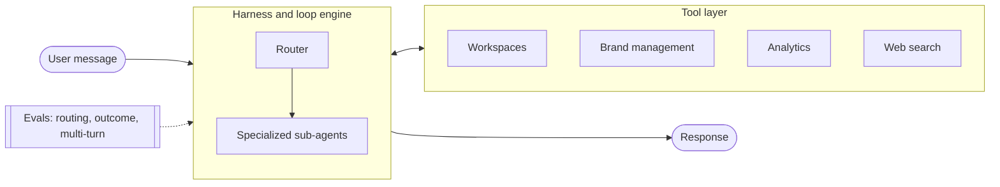

<div align="center">

<picture>
  <source media="(prefers-color-scheme: dark)" srcset="https://readme-typing-svg.demolab.com?font=JetBrains+Mono&weight=600&size=22&duration=3200&pause=1200&color=58A6FF&center=true&vCenter=true&width=700&height=44&lines=Forward+Deployed+Engineer;AI+Solutions+Architect;agents+%C2%B7+harnesses+%C2%B7+evals+%C2%B7+cost+control">
  <source media="(prefers-color-scheme: light)" srcset="https://readme-typing-svg.demolab.com?font=JetBrains+Mono&weight=600&size=22&duration=3200&pause=1200&color=0969DA&center=true&vCenter=true&width=700&height=44&lines=Forward+Deployed+Engineer;AI+Solutions+Architect;agents+%C2%B7+harnesses+%C2%B7+evals+%C2%B7+cost+control">
  
</picture>

</div>

```text
musa@prod:~$ whoami
musa-anwaar    # forward deployed engineer, ai solutions architect

musa@prod:~$ cat now.txt
ai engineer at ContentStudio
agentic chat · agent harnesses · evals · generative video · ai cost control

musa@prod:~$ cat before.txt
forward deployed engineer at Quest, client projects delivered through Pathfindr
```

I build agentic systems and ship them to production. I like owning the whole loop: scope the problem with the customer, architect it, build it, and measure whether it worked.

---

## Selected work

### Agentic chat and harness engineering · ContentStudio

- Took the agentic chat from a single Agno agent to a multi-agent team with specialized sub-agents.
- Built the tool layer that lets it act across the platform: workspaces, brand management, analytics and web search.
- Shipped a custom harness and loop engine, inspired by Hermes Agent, to replace Agno, so the chat responds right away, knows what it can do and recovers from errors on its own.

A simplified view of the shape:



| Impact | Result |
|---|---|
| Time to first word | 3.7x faster |
| Full responses at p99 | 12.4x faster |
| Model cost in evals | 57% lower |
| Memory at peak load | ~50% lower |
| Eval scores | Higher on routing, outcome and multi-turn |

Same prompts, workspace and model.

### Generative video pipelines and AI cost control · ContentStudio

- Launched AI video generation end to end on Fal.
- Built a dynamic costing matrix and credit-based metering, and moved video and credit workflows to async (Dramatiq, Temporal, Kafka).
- Built an AI clipping pipeline on Temporal: Deepgram speech-to-text, an LLM picks segments, then the video is cut and captioned.
- Built an internal vendor spend dashboard pulling cost, margin and usage from the admin APIs of Fal, OpenAI, Anthropic, OpenRouter, Deepgram, Firecrawl, Temporal and Exa.

### Client delivery · Forward Deployed Engineer at Quest (Pathfindr)

- **National accreditation body in Australia:** scoped and architected an AI agent that checks accreditation reports against ISO clauses, and led the team that built it. ~40% faster reviews, ~80% higher compliance accuracy.
- **Large retail group:** alert prioritization system across Dynatrace and PagerDuty. ~75% less alert noise.
- **Sparky:** AI platform that automates business reporting and lets teams explore their data through chat.

---

## Stack

| Area | Tools |
|---|---|
| **Languages** | `Python` `TypeScript` `JavaScript` |
| **AI & Agents** | `Multi-agent systems` `RAG` `Tool calling` `MCP` `Agent harnesses` `Evals` · `Agno` `Hermes Agent` `LangChain/LangGraph` · `Claude` `OpenAI` `Gemini` `Fal` `Deepgram` `OpenRouter` |
| **Backend & Ops** | `FastAPI` `Flask` `Next.js` `React` · `Temporal` `Dramatiq` `Kafka` · `CI/CD` `Doppler` |
| **Cloud & Data** | `Azure` `AWS` `DigitalOcean` `Hetzner` · `PostgreSQL` `MongoDB` `Supabase` `Chroma` |

---

## Say hello

If you're building with agents and want a second pair of hands that ships, I'm easy to reach.

[](https://linkedin.com/in/musa-anwaar/)
[](https://musa-anwaar.vercel.app/)

<!--
OPTIONAL STATS BLOCK (left off on purpose).
The cards below only count PUBLIC repos. Today that means 2 repos and Java only
(ClinicManagementSystem), which undersells the work above. Uncomment once there
are public repos with real activity. Both services are third-party and can rate limit.

<div align="center">
<picture>
  <source media="(prefers-color-scheme: dark)" srcset="https://github-readme-stats.vercel.app/api?username=MusaAnwaar&show_icons=true&theme=github_dark&hide_border=true">
  <source media="(prefers-color-scheme: light)" srcset="https://github-readme-stats.vercel.app/api?username=MusaAnwaar&show_icons=true&theme=default&hide_border=true">
  
</picture>
<picture>
  <source media="(prefers-color-scheme: dark)" srcset="https://streak-stats.demolab.com?user=MusaAnwaar&theme=github-dark-blue&hide_border=true">
  <source media="(prefers-color-scheme: light)" srcset="https://streak-stats.demolab.com?user=MusaAnwaar&theme=default&hide_border=true">
  
</picture>
</div>
-->
